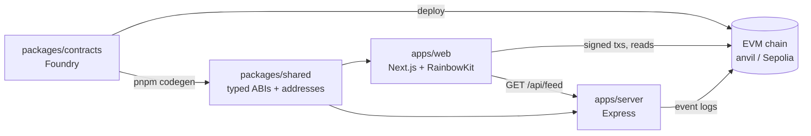

# eth-starter

A minimal EVM hackathon starter. Clone it, run one command, and you have a local chain, a
deployed contract, typed bindings, a backend and a wallet-connected web app, all wired together
and tested. No product logic, no paid services, no keys needed to run locally.

It ships with one small example contract (`SimpleEscrow`: lock ETH for someone, release or refund
it) so every layer has something real to exercise. Replace it with your idea.

## What it uses

| Layer         | Tools                                                                              |
| ------------- | ---------------------------------------------------------------------------------- |
| Monorepo      | pnpm workspaces, TypeScript (strict), Node 20                                      |
| Contracts     | Foundry (forge, anvil, cast), OpenZeppelin, forge-std                              |
| Contract → TS | wagmi CLI (generates typed ABIs + deployed addresses)                              |
| Web           | Next.js (App Router), React, wagmi, viem, RainbowKit, TanStack Query, Tailwind CSS |
| Server        | Express 5, viem                                                                    |
| Quality       | ESLint (typescript-eslint + eslint-config-next), Prettier, GitHub Actions          |

Exact versions and where each external value was verified: [VERIFIED.md](VERIFIED.md).

## Quickstart

Prerequisites:

- **Node 20.20.2**: `nvm use` (reads `.nvmrc`; Node ≥ 20.19 works)
- **pnpm 10.15.0**: `corepack enable` (version is pinned in `package.json`)
- **Foundry v1.8.7** ([install docs](https://getfoundry.sh/introduction/installation)):
  ```sh
  curl -L https://foundry.paradigm.xyz | bash
  foundryup --install v1.8.7
  ```

Then:

```sh
pnpm install
pnpm dev
```

Open http://localhost:3000. `pnpm dev` starts a local chain (anvil), deploys the contracts,
generates typed bindings, and runs the server (http://localhost:8787) and the web app.

**Wallet on the local chain.** Your browser wallet needs local ETH. Either import one of anvil's
dev accounts (keys are printed in `.anvil/anvil.log`; they are public, use them only locally) or
send yourself some:

```sh
cast send <your-address> --value 10ether --rpc-url http://127.0.0.1:8545 \
  --private-key $(cast wallet private-key "test test test test test test test test test test test junk")
```

Every `pnpm dev` starts a fresh chain, so clear your wallet's cached activity for the local
network after a restart, or transactions can hang on a stale nonce.

## How it works



- **Codegen, not copy-paste.** The deploy script writes addresses to
  `packages/shared/deployments/<chainId>.json`; `pnpm codegen` turns every contract in
  `packages/contracts/src` into typed `xxxAbi` / `xxxAddress` exports that the web app, server and
  scripts import. CI fails if they are out of date.
- **Safe writes.** `useTx()` in the web app simulates each call first (revert reasons show before
  the wallet opens), then signs, waits for the receipt and refreshes reads. `<TxStatus>` shows
  each step with an explorer link.
- **One chain per app.** `NEXT_PUBLIC_CHAIN_ID` (web) and `CHAIN_ID` (server, scripts) pick the
  active chain; RPC URLs are plain env overrides. A wallet on another network gets a
  "Wrong network" button that switches it.
- **Server for what shouldn't run in the browser.** The example polls escrow events and serves
  them at `/api/feed`.

More detail: [docs/ARCHITECTURE.md](docs/ARCHITECTURE.md).

## Commands

| Command                       | What it does                                                                           |
| ----------------------------- | -------------------------------------------------------------------------------------- |
| `pnpm dev`                    | Local chain + deploy + codegen + server + web                                          |
| `pnpm dev:testnet`            | Server + web only, using each app's `.env` (e.g. pointed at Sepolia)                   |
| `pnpm test`                   | Foundry tests (unit, fuzz, invariant; fork test if `FORK_RPC_URL` is set) + TS tests   |
| `pnpm e2e:happy`              | Runs the full flow (contract + server) the way the UI does. Run it before touching UI. |
| `pnpm codegen`                | Rebuild contracts and regenerate typed ABIs/addresses                                  |
| `pnpm deploy:local`           | Redeploy to a running local chain, then codegen                                        |
| `pnpm deploy:sepolia`         | Deploy to Sepolia with your Foundry keystore, then codegen                             |
| `pnpm typecheck`              | TypeScript across all packages                                                         |
| `pnpm lint` / `pnpm lint:fix` | ESLint (style rules are warnings, never errors)                                        |
| `pnpm format`                 | Prettier                                                                               |

## Layout

```
apps/
  web/          Next.js app: app/app.tsx is the page, components/ holds its parts
  server/       Express API: /health, /api/feed
packages/
  contracts/    Foundry project: example contract, tests, deploy script
  shared/       chain configs + generated ABIs/addresses
scripts/        pnpm dev orchestrator, e2e:happy
docs/           ARCHITECTURE.md
VERIFIED.md     every external value, its source and check date
```

## Building on it

1. **Contract:** replace `packages/contracts/src/SimpleEscrow.sol` and its tests, deploy yours in
   `script/Deploy.s.sol` (add it to the JSON there), then `pnpm codegen`. New contracts are
   picked up automatically.
2. **UI:** replace the escrow components in `apps/web/src/components/` and the panels in
   `app/app.tsx`. Keep `lib/use-tx.ts`, `components/tx-status.tsx` and
   `components/connect-button.tsx`. Restyle with the tokens in `app/globals.css`.
3. **Server:** add routes in `apps/server/src/index.ts`.
4. **Test the flow:** update `scripts/e2e-happy.ts` to your happy path and keep it green.

To add a chain, add it to `packages/shared/src/chains.ts` (metadata comes from `viem/chains`),
deploy, and run `pnpm codegen`.

## Deploying to Sepolia

1. Deploy and verify the contracts: [packages/contracts/README.md](packages/contracts/README.md)
   (Etherscan, Blockscout and Sourcify instructions).
2. Point the apps at Sepolia: `NEXT_PUBLIC_CHAIN_ID=11155111` in `apps/web/.env.local`,
   `CHAIN_ID=11155111` in `apps/server/.env` (plus RPC URLs if you have them).
3. `pnpm dev:testnet`, then `pnpm e2e:happy` with the root `.env` set for Sepolia.

## Environment

Nothing is needed locally. Every `.env.example` is commented with doc links.

| File                              | For                        | Testnet values                                                                        |
| --------------------------------- | -------------------------- | ------------------------------------------------------------------------------------- |
| `.env.example`                    | `pnpm e2e:happy`           | `CHAIN_ID`, `RPC_URL`, `E2E_PRIVATE_KEY` (throwaway key)                              |
| `apps/web/.env.example`           | web (`.env.local`)         | `NEXT_PUBLIC_CHAIN_ID`, `NEXT_PUBLIC_RPC_URL`, `NEXT_PUBLIC_WALLETCONNECT_PROJECT_ID` |
| `apps/server/.env.example`        | server (`.env`)            | `CHAIN_ID`, `RPC_URL`                                                                 |
| `packages/contracts/.env.example` | deploy, verify, fork tests | `SEPOLIA_RPC_URL`, `ETHERSCAN_API_KEY` (Etherscan only)                               |

The WalletConnect project ID is optional: without it the app offers browser wallets only.
Never put a key that holds real funds in any `.env`.

## CI

`.github/workflows/ci.yml` runs on pushes and PRs: `contracts` (forge tests, generated bindings
up to date) and `typecheck` are meant to be required checks; `lint` is informational.

## License

MIT
