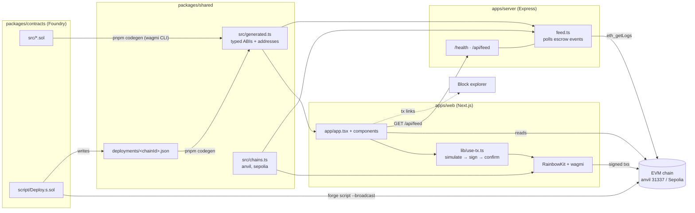

# Architecture

How the template fits together: where code lives, how data flows, and what to edit to swap a part.

## Flows

**Codegen (contract → TypeScript).** `forge script` deploys and writes
`packages/shared/deployments/<chainId>.json`. `pnpm codegen` runs the wagmi CLI Foundry plugin:
it builds the contracts and writes `src/generated.ts` with `xxxAbi` (`as const`) and
`xxxAddress` (`{ [chainId]: address }`) for every contract in `packages/contracts/src`. Web,
server and scripts import from `@starter/shared/generated`; nobody copies ABIs by hand. CI fails
if the committed `generated.ts` is stale.

**Writes (browser → chain).** Components call `useTx().send({ address, abi, functionName, args })`.
The hook simulates first (so revert reasons show before the wallet prompt), asks the wallet to
sign, waits for the receipt, then refreshes all reads. `TxStatus` shows each stage and an
explorer link.

**Server.** Express 5 on Node. `feed.ts` polls `SimpleEscrow` logs with `eth_getLogs` over a block
cursor and keeps the latest 100 entries in memory; `/api/feed` serves them. Put anything that
must not run in the browser here (secrets, indexing, webhooks).

**Active chain.** One env var per app selects it: `NEXT_PUBLIC_CHAIN_ID` (web), `CHAIN_ID`
(server, scripts). RPC URLs are plain env overrides; without one, viem's default public RPC is
used. The web app is configured for that single chain, so any other network in the wallet shows
"Wrong network" with a switch prompt.

**Local dev (`pnpm dev`).** `scripts/dev.ts` starts anvil (or reuses one on :8545), deploys with
anvil's dev account #0, runs codegen, then starts server and web against chain 31337. Restarting
gives a fresh chain with the same contract addresses (same deployer, same nonce).

## Swapping parts

| To change                 | Edit                                                                         |
| ------------------------- | ---------------------------------------------------------------------------- |
| Add a chain               | `packages/shared/src/chains.ts` (`SUPPORTED_CHAINS`), deploy, `pnpm codegen` |
| RPC provider              | `RPC_URL` / `NEXT_PUBLIC_RPC_URL` / `SEPOLIA_RPC_URL`                        |
| Explorer for verification | flags in `packages/contracts/README.md#verifying`                            |
| Server framework          | `apps/server/src/index.ts` (~30 lines)                                       |
| Feed storage              | `apps/server/src/feed.ts` (in-memory array → a database)                     |
| Look and feel             | tokens in `apps/web/src/app/globals.css`, primitives in `components/ui.tsx`  |
